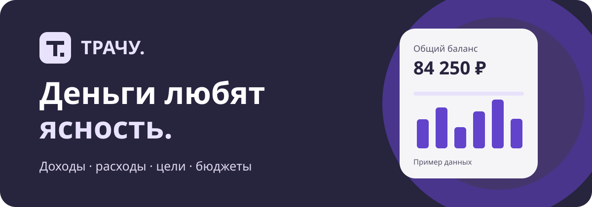
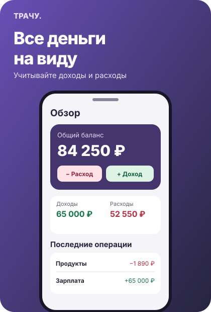
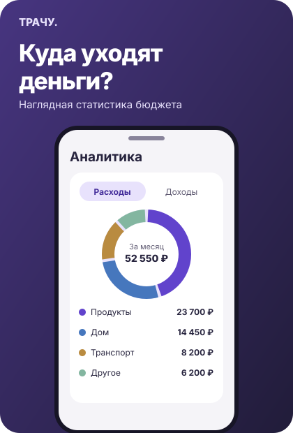
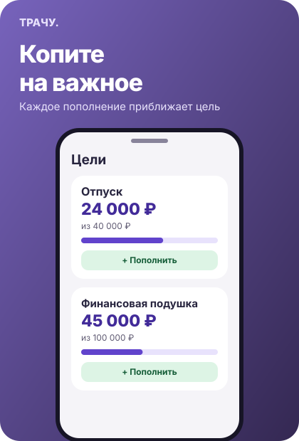

**Доходы, расходы, бюджеты и цели — в одном приложении.**

Бесплатно · Android 8.0+ · Без регистрации · Основные функции офлайн

[**Официальный сайт**](https://epbloger.github.io/trachu/) · [**Поддержка**](mailto:helpmoorkis@yandex.ru)

---

## Ваши деньги под контролем

ТРАЧУ. помогает понимать, сколько у вас денег, куда они уходят и сколько ещё осталось накопить. Записывайте повседневные расходы, планируйте бюджет и двигайтесь к своим целям.

<table>
<tr>
<td align="center"> <b>Баланс</b></td>
<td align="center"> <b>Аналитика</b></td>
<td align="center"> <b>Цели</b></td>
</tr>
</table>
Промо-иллюстрации возможностей приложения. Суммы условные.
  
<a href="https://epbloger.github.io/trachu/#screens"><b>Познакомиться с ТРАЧУ. →</b></a>

## Что умеет ТРАЧУ.

| Возможность | Что это даёт |
|---|---|
| Доходы и расходы | Записывайте операции, распределяйте по категориям, прикрепляйте чеки и отмечайте возвраты. |
| Счета и валюты | Контролируйте наличные и карты, переводите деньги между счетами, пользуйтесь конвертером. |
| Аналитика и бюджеты | Смотрите наглядную статистику, устанавливайте лимиты расходов и сравнивайте периоды. |
| Накопительные цели | Пополняйте накопления и следите за прогрессом. |
| Долги | Учитывайте задолженности, платежи и проценты. |
| Планирование | Календарь, регулярные платежи, напоминания и прогноз. |
| Быстрый доступ | Записывайте доходы и расходы с виджета, выбирайте светлую или тёмную тему. |
| Защита и копии | PIN, биометрия, резервные копии с паролем и экспорт отчётов. |

## Как начать

1. Добавьте счёт с текущим остатком и выберите основную валюту.
2. Записывайте доходы и расходы — достаточно суммы и категории.
3. Смотрите статистику, планируйте будущие платежи и пополняйте цели.

Приложение не подключается к банковским аккаунтам и не осуществляет платежи.

## Ваши финансы остаются у вас

Финансовые записи хранятся на вашем телефоне. Мы не храним их на своих серверах. Для основных функций не нужны аккаунт и интернет.

Приложение бесплатное. В коммерческой версии реклама может показываться только после отдельного согласия; отказаться можно без потери финансовых функций.

## Скачать

Приложение готовится к публикации в RuStore. Ссылка на скачивание появится на [официальном сайте](https://epbloger.github.io/trachu/#download) после выхода.

## Документы и поддержка

| Документ | Ссылка |
|---|---|
| Политика конфиденциальности | [На сайте](https://epbloger.github.io/trachu/privacy.html) · [Текст](docs/PRIVACY_POLICY.md) |
| Пользовательское соглашение | [На сайте](https://epbloger.github.io/trachu/terms.html) · [Текст](docs/TERMS.md) |
| О разработчике | [На сайте](https://epbloger.github.io/trachu/developer.html) · [Текст](docs/DEVELOPER.md) |

Документы также доступны в приложении.

**Moorkis Development** · [Написать в поддержку](mailto:helpmoorkis@yandex.ru)

Не отправляйте в открытых обращениях финансовую историю, персональные данные, чеки, банковские реквизиты, PIN и пароли.

---

<b>ТРАЧУ.</b> · Деньги любят ясность. © 2026 Moorkis Development. Все права защищены.

