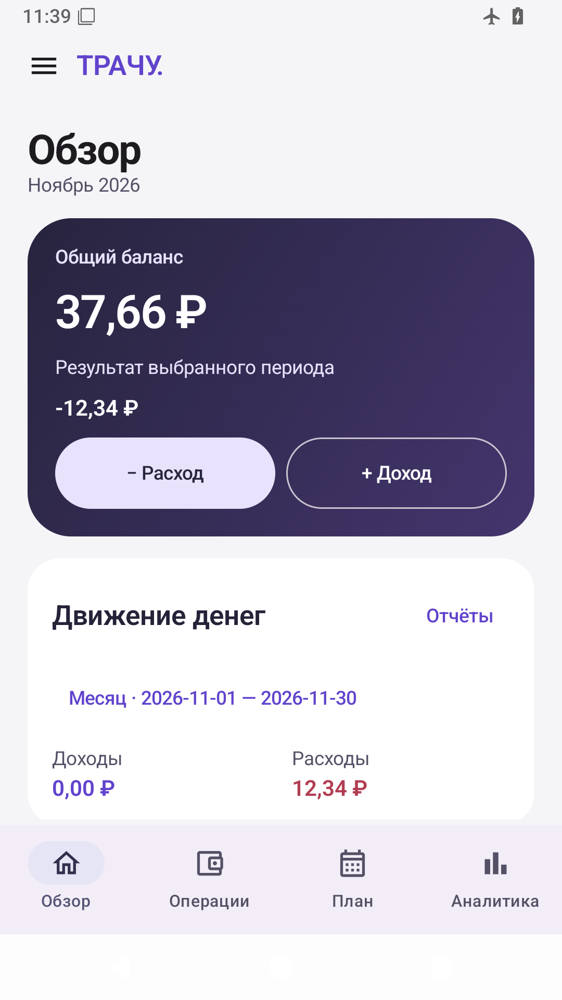
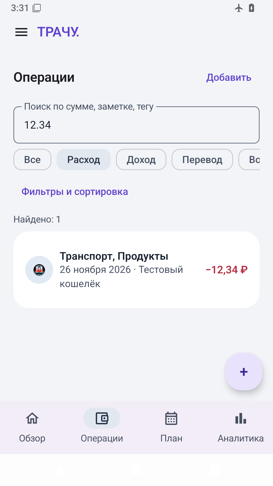
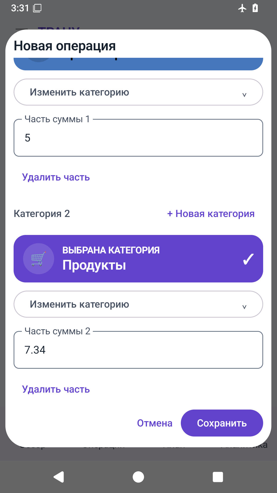
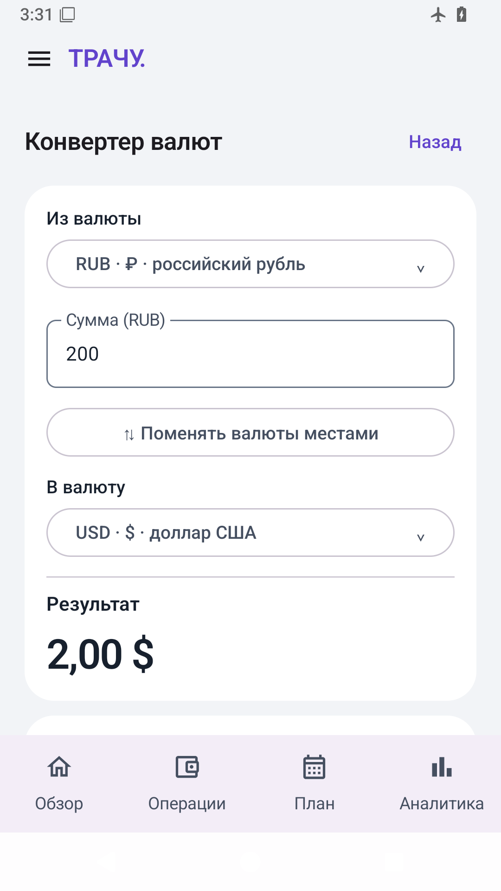
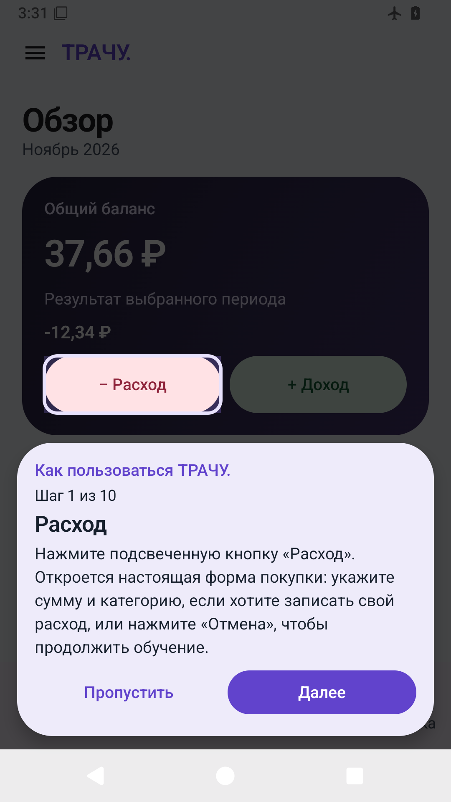

**Доходы, расходы, бюджеты и цели — в одном приложении.**

Android 8.0+ · Без регистрации · Основные функции офлайн

[**Сайт приложения**](https://epbloger.github.io/trachu/) · [**Релизы**](https://github.com/epbloger/trachu/releases) · [**Поддержка**](mailto:helpmoorkis@yandex.ru)

---

## ТРАЧУ.

ТРАЧУ. помогает вести личный бюджет, понимать расходы и планировать будущие платежи. Финансовые записи хранятся локально на устройстве; аккаунт и подключение к банковским сервисам не требуются.

## Возможности

| Возможность | Что это даёт |
|---|---|
| Доходы и расходы | Быстрый ввод, категории, история, теги, чеки и возвраты. |
| Счета и валюты | Наличные, карты, переводы и конвертер с курсами ЦБ, ручными курсами и офлайн-кешем. |
| Бюджеты | Лимиты по категориям, остатки и напоминания. |
| Цели и долги | Пополнение, снятие и история накоплений; погашение долга с учётом процентов. |
| Планирование | Календарь, регулярные платежи и прогноз баланса. |
| Аналитика | Структура доходов и расходов, фильтры, сравнение периодов и динамика. |
| Данные | Экспорт CSV/PDF, импорт поддерживаемых файлов и зашифрованные резервные копии. |
| Защита | PIN, биометрия и автоблокировка. |
| Оформление | Светлая, тёмная и системная темы, виджет быстрого доступа. |

## Интерфейс

  
  

 

 

 

## Как начать

1. При первом запуске выберите основную валюту и создайте счёт с начальным остатком.
2. Пройдите интерактивное обучение или пропустите его.
3. Записывайте расходы и доходы, выбирайте дату и категорию; новую категорию можно создать прямо из формы операции.
4. В меню доступны счета, категории, валюты, данные и копии, настройки и помощь.

## Ваши финансовые данные

Финансовые записи хранятся на вашем устройстве. Основные функции работают без регистрации и подключения к интернету. Интернет используется для получения официальных валютных курсов и, если реклама включена в конкретной сборке, показа баннера на обзоре. Банковской синхронизации нет.

[Политика конфиденциальности](docs/PRIVACY_POLICY.md) · [Условия использования](docs/TERMS.md) · [Разработчик](docs/DEVELOPER.md)

## Скачать

Ссылка на RuStore появится после публикации приложения.

## Обратная связь

**Moorkis Development**

[Написать в поддержку](mailto:helpmoorkis@yandex.ru) · [Сообщить об ошибке или предложить улучшение](https://github.com/epbloger/trachu/issues)

Не отправляйте в публичных обращениях финансовую историю, чеки, реквизиты и пароли.

© 2026 Moorkis Development. [Все права защищены](LICENSE).
