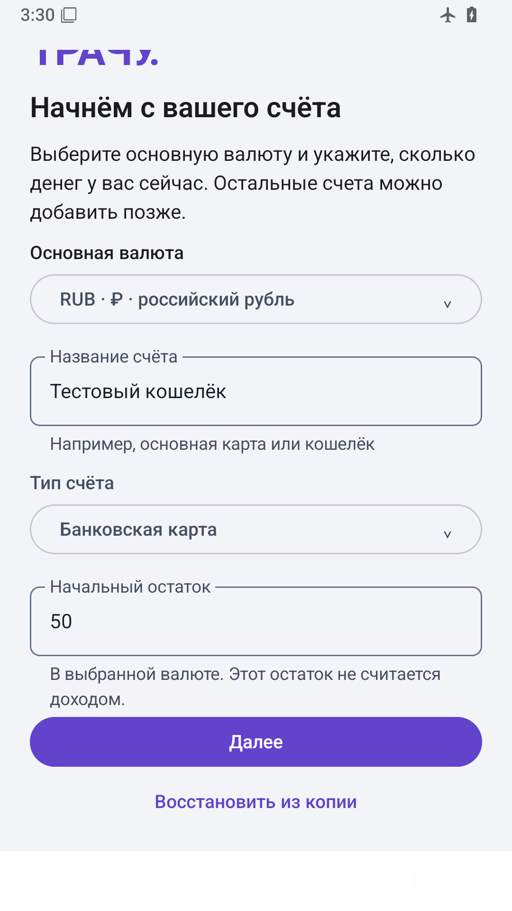
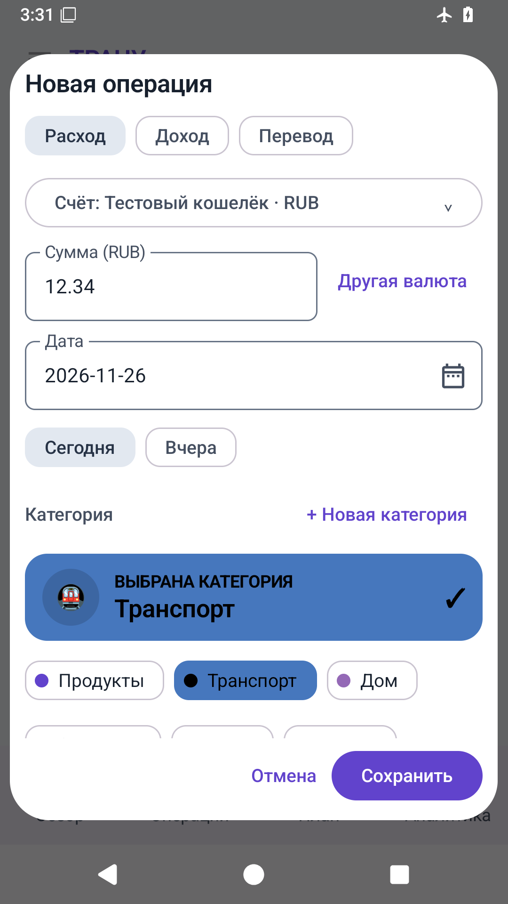
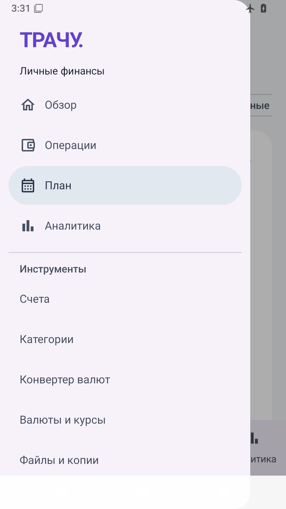
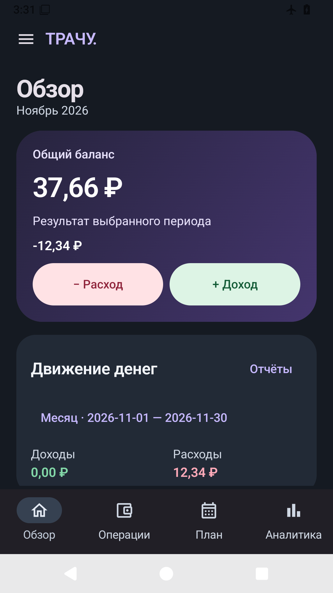
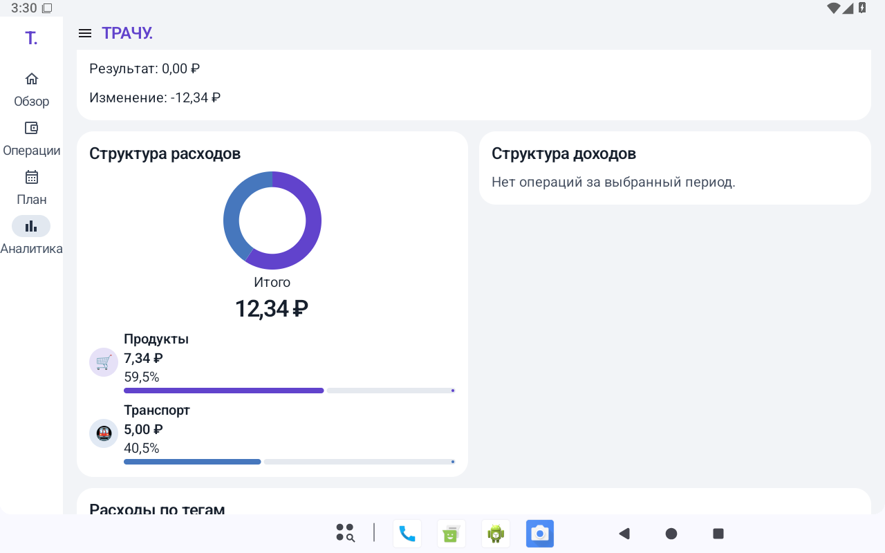

**Доходы, расходы, бюджеты и цели — в одном приложении.**

Android 8.0+ · Без регистрации · Основные функции офлайн

[**Сайт приложения**](https://epbloger.github.io/trachu/) · [**Релизы**](https://github.com/epbloger/trachu/releases) · [**Поддержка**](mailto:helpmoorkis@yandex.ru)

---

## Знакомьтесь: ТРАЧУ.

Сколько денег осталось до зарплаты? На что уходит больше всего? Как накопить на отпуск? ТРАЧУ. помогает вести личный бюджет, понимать свои расходы и планировать будущие платежи.

## Возможности

| Возможность | Что это даёт |
|---|---|
| Доходы и расходы | Быстрые даты, свои категории прямо при вводе, история, теги, чеки и возвраты. |
| Счета и валюты | Наличные, карты, переводы и конвертер с автоматическим обновлением курсов ЦБ, сохранёнными и ручными курсами. |
| Бюджеты | Лимиты по категориям, остатки и напоминания. |
| Цели и долги | Накопления, история пополнений, учёт долгов и погашений. |
| Планирование | Календарь, регулярные платежи и прогноз баланса. |
| Отчёты | Экспорт CSV и PDF, импорт поддерживаемых файлов. |
| Защита | PIN, биометрия, автоблокировка и резервные копии с паролем. |
| Оформление | Светлая, тёмная и системная темы, виджет быстрого доступа. |

## Реальный интерфейс

Реальные снимки проверенного Android-кода 1.1.0: [CI #45847845826](https://github.com/epbloger/trachu/actions/runs/45847845826), коммит [09aabc3](https://github.com/epbloger/trachu/commit/09aabc3cf14f381db30d166464740ff880f91908), 154/154 тестов. Суммы и записи тестовые. SHA окончательного main и контрольные суммы передаваемой сборки указываются отдельно в описании тестового релиза.

  
  

 

 

 

Подробности проверки: [отчёт о готовности](docs/QA_REPORT.md) и [сценарии ручной приёмки](docs/MANUAL_ACCEPTANCE.md).

## Как начать

1. При первом запуске выберите основную валюту и создайте счёт с начальным остатком.
2. Пройдите интерактивное обучение с подсветкой настоящих кнопок или пропустите его. Повторно оно доступно в боковом меню.
3. Записывайте расходы и доходы, выбирайте дату и категорию; новую категорию можно создать, не закрывая операцию.
4. В боковом меню доступны счета, категории, конвертер, настройки и резервные копии.

Приложение не подключается к банковским аккаунтам и не совершает платежи.

## Ваши финансовые данные

Финансовые записи хранятся на вашем устройстве. Основные функции работают без регистрации и подключения к интернету. Вы можете сохранить резервную копию с паролем и перенести её на другой телефон. Для получения официальных валютных курсов используется публичный сервис Банка России. В версии с подключённой рекламой небольшой баннер Яндекса может появляться на обзоре, но не во время записи операций; техническая обработка данных описана в политике конфиденциальности.

[Политика конфиденциальности](docs/PRIVACY_POLICY.md) · [Условия использования](docs/TERMS.md) · [Разработчик](docs/DEVELOPER.md)

## Скачать

Публичный выпуск готовится. Официальная ссылка на магазин появится после публикации. За выходом новых версий можно следить на [странице релизов](https://github.com/epbloger/trachu/releases).

Тестовый debug APK публикуется отдельным файлом на [странице релизов](https://github.com/epbloger/trachu/releases), только после полной проверки окончательного SHA main. Там же указываются SHA-256 и QA. Не устанавливайте unsigned release APK. Перед обновлением сделайте резервную копию; при несовместимой подписи не удаляйте приложение без сохранения данных. История проверок и ограничения — в [QA-отчёте](docs/QA_REPORT.md).

## Обратная связь

**Moorkis Development**

[Написать в поддержку](mailto:helpmoorkis@yandex.ru) · [Сообщить об ошибке или предложить улучшение](https://github.com/epbloger/trachu/issues)

Не отправляйте в публичных обращениях финансовую историю, чеки, реквизиты и пароли.

© 2026 Moorkis Development. [Все права защищены](LICENSE).
